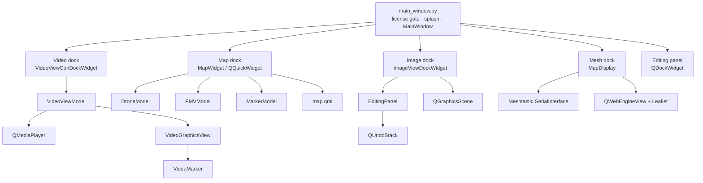
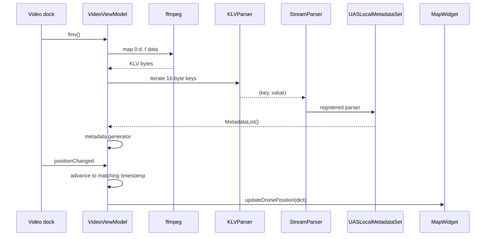
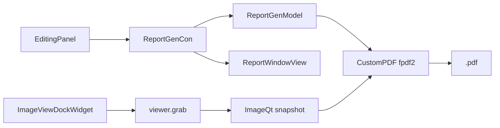
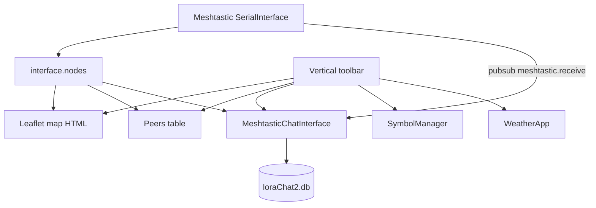

# SigTrack — Architecture

This document explains how SigTrack is put together: the runtime composition, the FMV telemetry pipeline, the map models, the imagery and mesh subsystems, and the build/packaging path. It is written against the code in this repository, including its current rough edges.

---

## 1. Shape of the application

SigTrack is a **single-process PySide2 (Qt 5) desktop application**. There is no server, no plugin host, and no database service. A `QMainWindow` owns a set of dock widgets; each dock is a workspace backed by a controller, one or more models, and Qt Designer UI modules.



### Entry point

`main_window.py`:

1. Calls `activateLicense()` (Keygen). On failure it logs and exits.
2. Creates `QApplication`, sets the window icon, and plays a rotate/scale splash animation from the `:/sigtrack` resource.
3. Constructs `MainWindow`, sets the title, and enters the Qt event loop.

`MainWindow.__init__` loads `Ui_MainWindow` from `form.ui`, enables animated/nested/tabbed docks, creates the editing panel dock, and wires menu actions to slot methods.

### Dock orchestration

`getDockIndex()` chooses the dock area from an internal `dockCount`:

| Count | Area |
|-------|------|
| 1 | Left |
| even | Bottom |
| odd (>1) | Top |

`Right` is defined but never selected. Closing a dock decrements `dockCount`; at zero, the central **Add a View** label returns.

`videoAction`, `imageAction`, `mapAction`, and `chatAction` each build a workspace and add it to the main window. `File → Import` actions call these and also ensure a map exists.

> Note: `MainWindow` instantiates an unused `MapWidget` in `__init__`. Each visible map is created separately by `mapAction()`, and `MapWidget` sets `mainWindow.map` to itself, so telemetry follows the most recently created map.

---

## 2. FMV and telemetry pipeline

### Playback

`VideoViewModel` owns a `QMediaPlayer` with a `VideoGraphicsView` output. The view hosts a `VideoGraphicsItem` (a `QGraphicsVideoItem`) plus a movable `VideoMarker` and its `MarkerIndicator`.

`VideoViewConDockWidget` is the controller. It loads `Ui_VideoView`, inserts the graphics view above the transport row, and binds play/stop/volume/seek/FMV/Marker/Mux.

### KLV extraction

Pressing **FMV** calls `VideoViewModel.fmv()`:

```text
ffmpeg -y -i <video> -map 0:d -c copy -copy_unknown -f data -
```

The command is executed with `subprocess.check_output`, so it blocks the UI thread while the data stream is dumped. The bytes are then parsed:



### Parser layout

| Module | Role |
|--------|------|
| `klvparser.py` | SMPTE ST 336 key/length/value reader; tolerates a leading junk byte before the UL |
| `streamparser.py` | Registry mapping 16-byte ULs to parser classes |
| `setparser.py` | Local-set container; `MetadataList()` flattens tags to `[name, value]` rows |
| `misb0601.py` | ST 0601 UAS Datalink Local Set tags |
| `misb0102.py` | ST 0102 Security Metadata Local Set |
| `misbEG0104.py` | EG 0104 Predator UAV Basic Universal Metadata Set |
| `element.py` | Element base classes and `UnknownElement` preservation |
| `common.py` | Mapping/string/date helpers |
| `fmvUtils.py` | Legacy geospatial helpers carried over from the FMV lineage |
| `FmvKlvReader.py` | Non-blocking stream reader, splitter, buffered metadata reader, timestamp helpers |

The parser lineage is MIT-licensed [`klvdata`](https://github.com/paretech/klvdata) by Matthew Pare; the MISB tag tables and Qt integration are SigTrack's.

### Synchronization

`VideoViewModel.on_position_changed` → `updateDurationInfo` converts the playhead to seconds and advances the metadata generator until the packet's **precision time stamp** is at or past the playhead. It then builds the drone dictionary and calls `mainWindow.map.updateDronePosition`.

Because the generator is forward-only:

- seeking backwards will not rewind metadata (the generator has already advanced),
- a stop/restart without pressing **FMV** again can desynchronize the map,
- long files make the first FMV index slow.

`VideoViewConDockWidget` contains a second, near-duplicate `updateDurationInfo` implementation that references an undefined `self.metadata`. It is not connected; the model's implementation is the live path. This is a cleanup target.

### Marker geometry

`VideoGraphicsView.updateData` takes the marker's normalized position in the video rectangle and interpolates between the frame center and corner offsets:

- latitude span from `Corner 1` to `Corner 4`,
- longitude span from `Corner 1` to `Corner 3`,
- percentage from marker x/y,
- popup text updated through `MarkerListModel.setMarker`.

This is a planar approximation. It does not account for terrain, lens distortion, or rotation beyond the KLV offsets.

---

## 3. Map subsystem

`MapWidget` is a `QQuickWidget` that loads `qrc:///map` (the compiled `map.qml`) and publishes three list models as QML context properties:

| Model | Roles | QML usage |
|-------|-------|-----------|
| `DroneModel` | `dronePosition`, `dronePath`, `heading`, `droneIcon` | Polyline trail, rotated platform icon |
| `FMVModel` | `polygonPoints`, `linePoints` | Footprint polygon, four beams, frame-center line |
| `MarkerModel` | position, source, tooltip, image path | Image pins with hover tooltip and click-to-open |

`iceController` exposes a `showImage(path)` slot to QML. Clicking a pin calls `application.js` → `ice.showImage` → `MapWidget.showImage` → `MainWindow.imageAction`, opening the image editor.

`map.qml` uses Qt Location 5.15 and the OSM plugin, with a layer combo backed by `supportedMapTypes` (street, cycle, transit, night transit, terrain, hiking), on-screen zoom buttons, and the layer group described above.

`FMVModel` (despite the name) is the footprint/beam model. `map_display.py` is unrelated: it is the separate Leaflet map used by the mesh workspace.

---

## 4. Imagery and reporting

### Import

`MainWindow.importImage` opens the file with `exif.Image`. If EXIF exists and GPS is present, DMS is converted to decimal degrees (`dms2dd`), stored in `images_dict`, and passed to `MapWidget.addMarker`. Missing GPS produces a modal warning.

### Editing

`ImageViewDockWidget` is a `QGraphicsView` over a `QGraphicsScene`:

| Component | Responsibility |
|-----------|----------------|
| `Painter` | Current pen/brush/font state |
| `TextItem` | Inline editable text item |
| `WatermarkItem` | Movable/scalable/rotatable pixmap overlay with handles |
| `AddCommand` | Undo/redo wrapper for committed items |
| `EditingPanel` | Toolbar, color/style controls, opacity, report button |

The panel's mode flags (`drawRect`, `drawCircle`, `drawLine`, `drawFreeHand`, `addText`, `watermark`, `zoomSelect`, `panSelect`) are mutually exclusive switches consulted by the view's mouse handlers. Shape previews are transient scene items; on release they are replaced by an undo command. The polygon flag exists but no polygon handler is implemented.

### PDF



`CustomPDF` subclasses `FPDF`, draws the logo from the `:/sigtrack_icon` resource in the header, then title, author, a separator line, and a footer page number. `ReportGenModel.save_pdf` grabs the view, asks for a snapshot path, saves it through `PIL.ImageQt`, embeds it, writes body text, and outputs the PDF.

---

## 5. Mesh workspace

`MapDisplay` is a `QMainWindow` embedded in a dock. On construction it opens `serial_interface.SerialInterface()` and reads `interface.nodes` once.



- **Map** — `QWebEngineView` with hand-built HTML: Leaflet from unpkg, Google tile URLs, OSM, and Leaflet.draw. Node markers are injected by string interpolation into `nodes_js_data`.
- **Chat** — `MeshtasticChatInterface` builds one `QRadioButton` per node, supports broadcast (`sendText(message)`) and direct (`sendText(message, destinationId=...)`), and subscribes to `meshtastic.receive`.
- **Peers** — `QTableWidget` populated from node metadata.
- **Symbols** — `SymbolManager` builds tabs from `icons_name` and PNGs under `models/chat/resources/Nato_Icons/`, compiled into `nato_icons_rc.py`.
- **Weather** — `requests` → OpenWeatherMap, fixed city and embedded demo key.
- **Persistence** — `ItemModel` opens `loraChat2.db` and creates `nodes`, `sent_messages`, `received_messages`.

`ChatModel.py` / `ChatView.py` are an older TCP chat prototype (`ChatClient` to `127.0.0.1:8000`) that is not used by the mesh workspace.

---

## 6. Licensing

`utils/activate_license.py`:

1. Reads `license.key` from the working directory.
2. Computes `machineid.hashed_id('Sigtrack')`.
3. POSTs to Keygen's `validate-key` endpoint with a fingerprint scope.
4. If the license is valid but unbound, POSTs to `/machines` to activate this machine.
5. Returns `(bool, message)`; `main_window.py` gates startup on it.

The Keygen account ID is embedded in the source, and the check is client-side. Both are deployment considerations if the product is redistributed.

---

## 7. Persistence and runtime files

| Path | Owner | Format | Notes |
|------|-------|--------|-------|
| `license.key` | deployment | plain text | Required at startup |
| `settings.json` | `ThemeSelectWindow` | JSON | Theme preference; not auto-created |
| `loraChat2.db` | `ItemModel` | SQLite | Chat/node tables |
| `output.ts` | `Multiplexor` | MPEG-TS | Fixed name |
| `sigtrack/resources/compiled/*_rc.py` | `pyside2-rcc` | Python | Generated resources |
| `sigtrack/models/chat/*_rc.py` | `pyside2-rcc` | Python | Generated icon resources |

The runtime files above are resolved relative to the **current working directory**, not the package; compiled resources are imported from the package.

---

## 8. Threading and subprocesses

| Work | Mechanism | UI risk |
|------|-----------|---------|
| KLV demux on **FMV** | `subprocess.check_output` | Blocks the UI while dumping |
| Buffered metadata | `callBackMetadataThread` (daemon) | One FFmpeg process per interval |
| Live stream splitting | `Splitter` + `NonBlockingStreamReader` | Present but not used by the player |
| Legacy TCP chat | `ChatClient` receive thread | Prototype only |
| Meshtastic receive | `pubsub` callback | Runs on the library thread; chat UI updates directly |

There is no asyncio loop and no worker-pool abstraction. Anything expensive added to a slot runs on the Qt main thread.

---

## 9. Build and packaging

- **UI** — `form.ui` is checked in. The dock UI modules (`ui_videoview.py`, `ui_markerpopup.py`, `ui_report_window_view.py`) were generated from `.ui` sources that are not in the repository. There is no build script; regenerate `form.ui` with `pyside2-uic` after editing it.
- **Resources** — `.qrc` files live under `sigtrack/resources/icons/` and `sigtrack/models/chat/`; generated `*_rc.py` files are imported at runtime. `.gitignore` excludes `*_rc.py`, but the compiled files are tracked in this repository.
- **Executable** — `SigTrack.spec` is a PyInstaller one-file spec. It bundles `ffmpeg/ffmpeg.exe` and `ffmpeg/ffprobe.exe`, includes `qt_material`, and uses `sigtrack.ico`.

```bash
pyinstaller SigTrack.spec
# -> dist/SigTrack.exe
```

- **Dependencies** — `requirements.txt` is the runtime manifest (UTF-16 encoded). `pyproject.toml` is stale Poetry metadata: it points at a `sigtrack_dev` package that does not exist and lists only `exif`, `qt-material`, and `hotreload`.

---

## 10. Technical debt and constraints

| Area | Issue |
|------|-------|
| Platform | Hard-coded `ffmpeg/ffmpeg.exe`, `C:\...` dialog defaults, Windows-only spec |
| Qt versions | `requirements.txt` pins PySide2 **and** PySide6; runtime is PySide2 only |
| Telemetry seek | Forward-only metadata generator; no rewind/resync |
| Dead code | Controller duplicate of `updateDurationInfo`; `mux.py` empty; TCP chat prototype |
| Mesh DB | `add_sent_message` / `add_receive_message` use `self.conn` instead of `self.connection` |
| Peers table | Six columns declared, seven written |
| Settings | Theme picker assumes `settings.json` exists |
| Tests | `tests/` contains only `__init__.py` |
| Security | Weather API key and Keygen account ID are embedded in source |
| Map | No packaged offline map, no single map instance, manual HTML string interpolation for mesh nodes |

Fixing these is tracked informally; see [CONTRIBUTING.md](CONTRIBUTING.md) for the manual regression checklist that stands in for a test suite.

---

## 11. Where to change what

| Change | Start here |
|--------|-----------|
| Add a MISB field | `sigtrack/klv_data/misb0601.py`, then the dictionary in `videoviewModel.py` |
| Change map symbology | `sigtrack/views/mapview/map.qml` and the models in `sigtrack/models/map_models/` |
| Add a drawing tool | `EditingPanel` + `ImageViewDockWidget` mouse handlers |
| Change the PDF layout | `sigtrack/models/image_models/pdfgen/custompdf.py` |
| Add a mesh panel | `sigtrack/models/chat/map_display.py` toolbar + a widget |
| Change startup/licensing | `main_window.py`, `sigtrack/utils/activate_license.py` |
| Change bundled files | `SigTrack.spec` |
