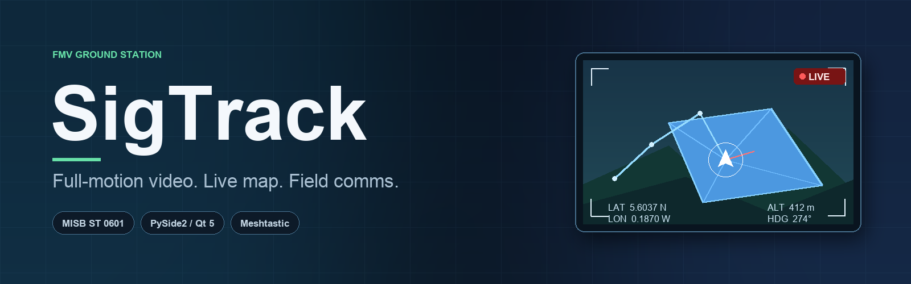
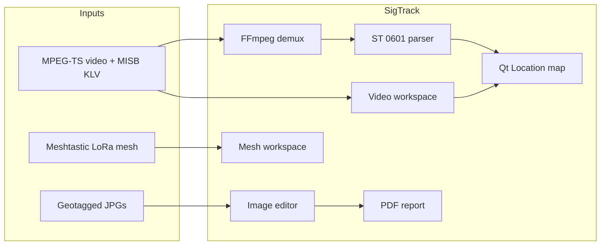

<p align="center">
  
</p>

<h1 align="center">SigTrack</h1>

<p align="center">
  <strong>Play MISB video. Track the sensor on the map. Stay on comms.</strong>
</p>

<p align="center">
  <a href="https://www.python.org/"></a>
  <a href="https://doc.qt.io/qtforpython-5/"></a>
  <a href="https://meshtastic.org/"></a>
  <a href="https://www.microsoft.com/windows"></a>
  <a href="#license"></a>
</p>

<p align="center">
  <a href="USAGE.md">User guide</a> ·
  <a href="ARCHITECTURE.md">Architecture</a> ·
  <a href="CONTRIBUTING.md">Contributing</a> ·
  <a href="https://github.com/Serkhani/SigTrack/releases">Releases</a> ·
  <a href="https://github.com/Serkhani/SigTrack/issues">Issues</a>
</p>

---

## What it does

SigTrack is a desktop **full-motion video (FMV) ground station**. It plays MPEG-TS / H.264 video, decodes the MISB KLV telemetry embedded alongside it, and keeps a Qt Location map synchronized with the sensor: platform position and heading, flight path, sensor footprint, and frame-center line.

Around that core it adds an imagery workflow — geolocate JPGs from EXIF, annotate them, and export a PDF report — plus a **Meshtastic** mesh workspace with chat, a live node map, peer telemetry, NATO symbology, and weather.



The KLV reader is derived from Matthew Pare's MIT-licensed [`klvdata`](https://github.com/paretech/klvdata) and understands **ST 0601**, **ST 0102**, and **EG 0104** local sets. Everything else — playback, map symbology, annotation, reporting, and mesh comms — is SigTrack's own PySide2/Qt application code.

---

## Highlights

| Feature | What you get |
|---------|--------------|
| **FMV playback** | Qt Multimedia player with play/pause, stop, volume, seek, and timecode |
| **MISB / KLV telemetry** | ST 0601 tag decoding: platform heading, sensor lat/lon, frame center/elevation, corner offsets |
| **Live map symbology** | Drone icon rotated by heading, flight trail, footprint polygon, four beam lines, red frame-center line |
| **Video markers** | Place and drag a pin on the frame; its ground position is interpolated from the corner offsets |
| **Multiplexer** | Mux an MP4/AVI with a telemetry log into `output.ts` with FFmpeg |
| **Image intelligence** | Import single JPGs or folders; EXIF GPS is converted from DMS and pinned to the map |
| **Annotation studio** | Rectangle, circle, line, freehand, text, and repositionable watermark with undo/redo |
| **PDF reports** | Branded report with page header, annotated snapshot, author/title/content, and page numbers |
| **Mesh chat** | Meshtastic serial link, broadcast and direct messages, per-node radio list, SQLite schema |
| **Situational awareness** | Leaflet node map with satellite/terrain/hybrid/OSM layers and drawing tools |
| **Peers & weather** | Node table (hardware, MAC, last heard, SNR, battery) and an OpenWeatherMap panel |
| **NATO symbology** | 16 APP-6 style categories (friend/hostile/neutral/unknown × air/land/equipment/subsurface) |
| **Themes** | `qt-material` theme picker persisted to `settings.json` |
| **Licensing** | Machine-bound Keygen license validation at startup |

---

## Requirements

| Component | Required | Notes |
|-----------|----------|-------|
| **Python** | Yes | 3.9 with PySide2 5.15 wheels |
| **PySide2 / Qt 5.15** | Yes | Widgets, QtMultimedia, QtLocation/QML, QtWebEngine |
| **FFmpeg + FFprobe** | Yes | KLV demux, telemetry buffering, and video multiplexing |
| **Keygen license** | Yes | A `license.key` file validated online at startup |
| **Meshtastic radio** | Optional | Only for the mesh chat workspace; opens a serial interface |
| **OpenWeatherMap key** | Optional | A demo key is embedded; replace it for production use |
| **Windows** | Recommended | Default paths, `.exe` binaries, and the PyInstaller target are Windows-first |

The runtime pins live in [`requirements.txt`](requirements.txt). It currently includes **both PySide2 and PySide6** even though the application imports PySide2 only — install it as-is, but do not mix toolkits in new code.

---

## Install

### From source

```bash
git clone https://github.com/Serkhani/SigTrack.git
cd SigTrack

py -3.9 -m venv .venv
.venv\Scripts\activate

python -m pip install --upgrade pip
python -m pip install -r requirements.txt
```

On macOS/Linux, create and activate the environment with `python3.9 -m venv .venv && source .venv/bin/activate`; the application still expects the Windows FFmpeg layout unless you edit the paths.

> `requirements.txt` is saved as UTF-16 with CRLF line endings. If pip cannot parse it, re-save it as UTF-8 or install the pinned packages directly.

### FFmpeg layout

The player and multiplexer invoke FFmpeg through **relative paths**, so put both binaries in an `ffmpeg/` folder in the working directory:

```text
SigTrack/
├── main_window.py
├── license.key
└── ffmpeg/
    ├── ffmpeg.exe
    └── ffprobe.exe
```

The buffered KLV reader reads `ffmpegConf` from [`sigtrack/klv_data/constants.py`](sigtrack/klv_data/constants.py); set it to `ffmpeg` (or an absolute path) to match. The player (`videoviewModel.py`) and multiplexer (`full_motion_video_mux.py`) hard-code `ffmpeg/ffmpeg.exe` and `ffmpeg/ffmpeg` respectively, so edit those for a different layout.

### License key

SigTrack validates a [Keygen](https://keygen.sh/) license against a machine fingerprint on every start. Put the issued key in **`license.key`** next to `main_window.py`:

```text
license.key      # one line, no quotes
```

Without it the app logs `No license key file found` and exits.

### Run

```bash
python main_window.py
```

### Packaged Windows build

```bash
pyinstaller SigTrack.spec
```

The result is `dist/SigTrack.exe` (or `dist/SigTrack` on other platforms); [`SigTrack.spec`](SigTrack.spec) already bundles `ffmpeg/ffmpeg.exe` and `ffmpeg/ffprobe.exe` and applies the application icon.

---

## Quick start

1. Launch the app and let the splash animation finish. The license check runs first.
2. **View → Map** (`F1`) opens the map dock.
3. **File → Import → Video → File(s)** (`Ctrl+Shift+F`) and pick a `.ts`, `.mp4`, or `.mov`.
4. Press **FMV** (`Ctrl+F`) once. This indexes the embedded KLV stream; after that, the playhead drives the map.
5. Press play. The drone icon, trail, footprint, and frame-center line update as the video advances.
6. Press **Marker** (`Ctrl+I`) to show the marker panel, then click **Add Marker** and drag the pin over an object of interest.
7. **File → Import → Image → File(s)** (`Ctrl+Alt+F`) adds EXIF-geotagged JPGs to the map. Click a pin to open the annotation editor.
8. **View → Chat** opens the mesh workspace — connect a Meshtastic radio first, or the serial interface will have no nodes.

No MISB metadata in your clip? Use **Mux** in the player (`Ctrl+M`) to combine a video and a telemetry log.

---

## Video workspace

**File → Import → Video → File(s)** creates one dock per clip. Each dock is a small transport bar plus the video surface:

| Control | Shortcut | Behavior |
|---------|----------|----------|
| **Play / Pause** | `Space` | Toggles playback and swaps the icon |
| **Stop** | `Esc` | Stops and rewinds the slider to zero |
| **Volume** | — | Slider bound directly to `QMediaPlayer` volume |
| **Seek** | — | Scrubbing sets the player position in seconds |
| **FMV** | `Ctrl+F` | Demuxes and parses KLV, then wires position changes to the map |
| **Marker** | `Ctrl+I` | Shows or hides the marker panel; **Add Marker** places the pin |
| **Mux** | `Ctrl+M` | Opens the multiplexer dialog |

### Telemetry sync

Pressing **FMV** runs:

```text
ffmpeg -y -i <video> -map 0:d -c copy -copy_unknown -f data -
```

The raw KLV stream is split by the SMPTE ST 336 parser and decoded set by set. On every `positionChanged`, the player selects the metadata packet whose precision timestamp is at or past the playhead and updates:

- sensor latitude / longitude and platform heading,
- frame-center latitude / longitude / elevation,
- the four offset corners.

Those values are handed to the map models, so the QML map never polls the video: the player pushes.

Indexing blocks the UI while FFmpeg dumps the stream. Long clips take a moment; the map begins moving once indexing completes. On very long files the parse can fall behind the playhead — see [Known limitations](#known-limitations).

### Video markers

A marker is a `QGraphicsPixmapItem` over the video surface with a color indicator. Its latitude/longitude are estimated from its normalized position inside the frame, using the frame center plus the four corner offsets from the current KLV packet. The popup text refreshes as playback continues, so one marker can track a fixed object across a pass.

### Multiplexer

**Mux** asks for three paths — video, telemetry log (`.log`), output directory — and runs:

```text
ffmpeg/ffmpeg -i <video> -i <log> -map 0 -map 1 -c:v copy -c:a copy -c:m copy <out>/output.ts
```

The output name is fixed to `output.ts`. Validate the result by reopening it and pressing **FMV**.

---

## Map workspace

The map is a `QQuickWidget` hosting Qt Location's OSM plugin. It renders these synchronized layers:

| Layer | Source | Visual |
|-------|--------|--------|
| **Platform** | `DroneModel` | 70 px drone icon rotated by `Platform Heading Angle` |
| **Trajectory** | `DroneModel` | Blue polyline of every position received |
| **Footprint** | `FMVModel` | Translucent polygon from the four corner offsets |
| **Beams / frame center** | `FMVModel` | Four sensor lines plus a red frame-center line |

The layer switcher exposes **Street, Cycle, Transit, Night Transit, Terrain, and Hiking** map types. Tiles come from OpenStreetMap, so the map needs network access on first load.

**Image pins** work independently of video: each EXIF-located JPG becomes a marker with a tooltip, and clicking it opens that image in the annotation editor.

---

## Imagery and reports

### Import

**File → Import → Image → File(s)** or **Folder** reads EXIF GPS. DMS coordinates are converted to decimal degrees; images without GPS produce a warning dialog instead of a pin. A map dock is opened automatically if none exists.

### Annotation

The editing panel is a floating dock on the left. It exposes:

- **Undo / redo** (`Ctrl+Z` / `Ctrl+Y`, `QUndoStack`-backed)
- **Shapes**: rectangle, circle, line, freehand
- **Text** with point size and bold
- **Watermark**: load PNG/JPG/BMP, then move, scale (bottom-right handle), rotate (top-right handle), and change opacity
- **Stroke**: enable, color, width; **Fill**: enable, color, opacity
- **View**: extent, zoom in/out, zoom selection, pan, mouse-wheel zoom

Every committed item goes through an `AddCommand`, so undo/redo covers the whole session.

### PDF report

Press **Generate PDF Report** in the editing panel. Fill in author, title, and body, choose the output path, and SigTrack:

1. grabs the current annotated view,
2. writes the snapshot to an image file,
3. embeds it in an `fpdf2` document with the SigTrack logo in the header, the report title and author, body text, and page numbers in the footer.

When prompted for the snapshot, choose a **`.png`**, `.bmp`, or `.xpm` path; `.jpg` is rejected by the report writer.

---

## Mesh workspace

**View → Chat** opens the mesh window. It connects to a Meshtastic radio over the default serial interface and lays out the node data three ways:

- **Map** — Leaflet with Google satellite, terrain, hybrid, and OSM base layers, node pins with short-name popups, and draw/edit tools.
- **Chat** — a node selector (radio buttons), a broadcast toggle, and direct messages. Incoming packets arrive through `pubsub` on `meshtastic.receive`.
- **Peers** — hardware model, MAC, last heard, SNR, and battery level per node.

Two more panels complete the workspace: **NATO symbols** (16 tabs of APP-6 icons) and **weather** (current conditions for a configured city from OpenWeatherMap). The chat model opens `loraChat2.db` in the working directory and defines node and message tables; the write helpers are still being completed (see [Known limitations](#known-limitations)).

The radio, not the desktop app, defines the network. If no nodes are discovered, the map and peer table stay empty; check the USB serial connection and the radio's channel first.

---

## Documentation

All documentation is Markdown in this repository:

| Doc | Audience |
|-----|----------|
| [**USAGE.md**](USAGE.md) | End users — workspaces, tools, shortcuts, troubleshooting |
| [**ARCHITECTURE.md**](ARCHITECTURE.md) | Developers — modules, data flow, persistence, build |
| [**CONTRIBUTING.md**](CONTRIBUTING.md) | Developers — setup, conventions, test checklist |

---

## Project layout

```text
SigTrack/
├── main_window.py              # Entry point, splash, license gate, dock orchestration
├── form.ui                     # Main window menus and toolbar (Qt Designer)
├── SigTrack.spec               # PyInstaller build (bundles FFmpeg)
├── pyproject.toml              # Poetry metadata (partial; see ARCHITECTURE.md)
├── requirements.txt            # Pinned runtime dependencies
├── assets/
│   └── banner.png              # README banner
├── sigtrack/
│   ├── controllers/            # Video, marker popup, report, remove-button controllers
│   ├── klv_data/               # KLV demux, ST 0601 / ST 0102 / EG 0104 parsers
│   ├── models/
│   │   ├── chat/               # Meshtastic interface, peers, symbols, weather, SQLite
│   │   ├── image_models/       # Painter, text/watermark items, undo commands, PDF
│   │   ├── map_models/         # Drone, footprint (FMV), and marker models
│   │   └── video_models/       # Player model, graphics view, markers, muxing
│   ├── resources/
│   │   ├── compiled/           # Generated `*_rc.py` resource modules
│   │   └── icons/              # QRC sources and SVG/PNG icons
│   ├── utils/                  # License activation and helpers
│   └── views/
│       ├── chat/               # Chat view
│       ├── imageview/          # Image viewer, editing panel, report dialog
│       ├── mapview/            # QQuickWidget host and `map.qml`
│       └── videoview/          # Video dock UI and marker popup
├── tests/                      # Placeholder — no automated suite yet
├── USAGE.md                    # End-user guide
├── ARCHITECTURE.md             # Developer architecture notes
├── CONTRIBUTING.md             # Development setup and review checklist
└── README.md
```

---

## Development

```bash
python -m venv .venv
.venv\Scripts\activate
python -m pip install -r requirements.txt

python main_window.py          # run from source
python -m compileall sigtrack main_window.py
```

**Tests:** `tests/` currently contains only `__init__.py`. There is no automated suite; use the manual checklist in [CONTRIBUTING.md](CONTRIBUTING.md#4-manual-test-checklist) before opening a pull request.

**Build:** `pyinstaller SigTrack.spec` → `dist/SigTrack.exe`.

**Conventions:** the app is PySide2 (Qt 5) throughout. Views are Qt Designer/Ui modules, models are `QAbstractListModel` or plain classes, and controllers glue them together. Generated `*_rc.py` files live under `sigtrack/resources/compiled/` and `sigtrack/models/chat/`.

---

## Known limitations

- **Windows-first paths.** The player calls `ffmpeg/ffmpeg.exe`, the multiplexer calls `ffmpeg/ffmpeg`, and file dialogs default to `C:\...`. macOS and Linux need path edits.
- **Dual Qt pins.** `requirements.txt` lists both PySide2 and PySide6; the codebase is PySide2-only.
- **KLV indexing is sequential.** Long recordings take a while, seeking backwards desynchronizes the metadata cursor, and a far-forward seek stalls the UI while the parser catches up.
- **Network dependencies.** OSM tiles, Keygen validation, and weather all require connectivity.
- **Mesh persistence is incomplete.** Some chat DB helpers reference an unset connection and the peer table declares six columns while writing seven.
- **No automated tests.** `tests/` is a placeholder.
- **Stale Poetry metadata.** `pyproject.toml` points at a non-existent `sigtrack_dev` package and omits most runtime dependencies; use `requirements.txt`.

---

## Standards & references

- [MISB ST 0601](https://gwg.nga.mil/misb/docs/standards/ST0601.17.pdf) — UAS Datalink Local Set
- [MISB ST 0102](https://gwg.nga.mil/misb/docs/standards/ST0102.12.pdf) — Security Metadata
- [MISB EG 0104](https://gwg.nga.mil/misb/docs/standards/EG0104.5.pdf) — Predator UAV Basic Universal Metadata Set
- [SMPTE ST 336](https://ieeexplore.ieee.org/document/7291463) — KLV encoding
- [Meshtastic](https://meshtastic.org/docs/) — LoRa mesh protocol and Python API
- [Qt Location](https://doc.qt.io/qt-5/qtlocation-index.html) — OSM plugin and QML map items
- [klvdata / paretech](https://github.com/paretech/klvdata) — MIT-licensed parser lineage in `sigtrack/klv_data/`

---

## Support

Use SigTrack at your own risk and report defects in [Issues](https://github.com/Serkhani/SigTrack/issues). Include the video container, whether KLV is present (`ffprobe -show_streams`), your OS, and the Python/Qt versions.

For license, deployment, or integration questions, contact the maintainers through the repository.

---

## License

<a id="license"></a>

**Proprietary — all rights reserved.** This repository does not contain an open-source license file. Runtime use requires a Keygen-issued license (`license.key`). The KLV parsing modules under `sigtrack/klv_data/` retain their original MIT copyright notices from Matthew Pare.

---

**SigTrack contributors** · [@Serkhani](https://github.com/Serkhani) · [@jdboachie](https://github.com/jdboachie) · [@eddyblaze7](https://github.com/eddyblaze7)
